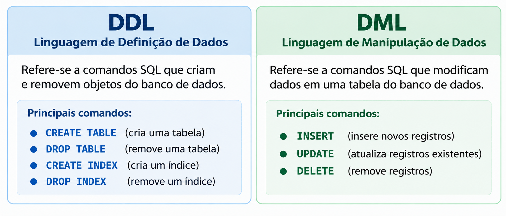
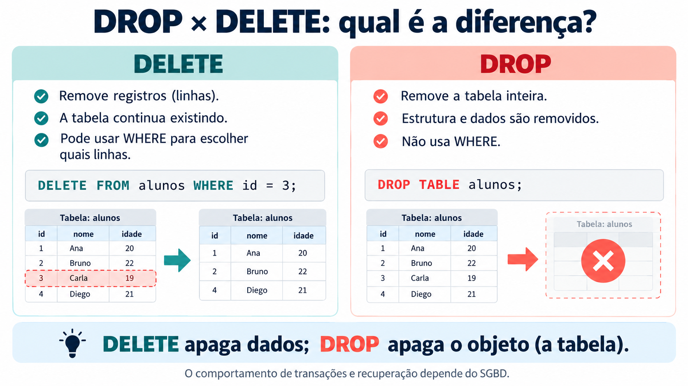
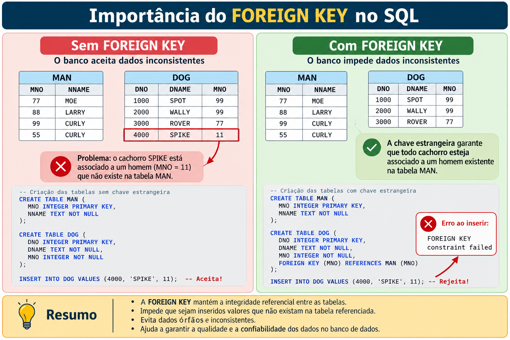
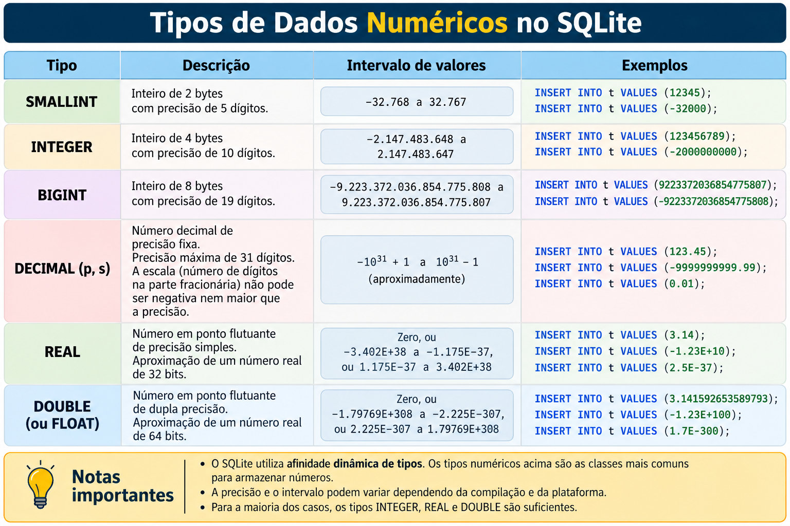

## Configurando Rstudio

```{r, echo=TRUE, warning=FALSE}
#| code-fold: FALSE
library(DBI)
library(RSQLite)
knitr::opts_chunk$set(max.print = Inf)
# Conecta/Cria o arquivo
con <- dbConnect(RSQLite::SQLite(), "criando_tabelas.sqlite")
```

# CREATE TABLE

## Exemplo 1: O que faz o seguinte código?


```{sql connection=con, eval=FALSE}
DROP TABLE DOG;
CREATE TABLE DOG (
  DNO INTEGER NOT NULL,
  DNAME CHAR(10) NOT NULL);
SELECT * FROM DOG;
INSERT INTO DOG VALUES (1000, 'SPOT');
SELECT * FROM DOG;
INSERT INTO DOG VALUES (3000, 'ROVER');
SELECT * FROM DOG;
INSERT INTO DOG VALUES (2000, 'WALLY');
SELECT * FROM DOG;
UPDATE DOG
SET DNAME = 'SPIKE'
WHERE DNO = 3000;
SELECT * FROM DOG;
UPDATE DOG
SET DNAME = 'REX'
WHERE DNAME LIKE 'S%';
SELECT * FROM DOG;
DELETE FROM DOG
WHERE DNAME = 'REX';
SELECT * FROM DOG;
DROP TABLE DOG;
```


## Vejamos passo a passo


```{sql connection=con}
DROP TABLE IF EXISTS DOG;
```

```{sql connection=con}
CREATE TABLE DOG (
  DNO INTEGER NOT NULL,
  DNAME CHAR(10) NOT NULL);
```

```{sql connection=con}
INSERT INTO DOG VALUES (1000, 'SPOT');
```

```{sql connection=con}
INSERT INTO DOG VALUES (3000, 'ROVER');
```

```{sql connection=con}
INSERT INTO DOG VALUES (2000, 'WALLY');
```

```{sql connection=con}
SELECT * FROM DOG;
```


```{sql connection=con}
UPDATE DOG
SET DNAME = 'SPIKE'
WHERE DNO = 3000;
```

```{sql connection=con}
SELECT * FROM DOG;
```


```{sql connection=con}
UPDATE DOG
SET DNAME = 'REX'
WHERE DNAME LIKE 'S%';
```

```{sql connection=con}
SELECT * FROM DOG;
```


```{sql connection=con}
DELETE FROM DOG
WHERE DNAME = 'REX';
```


```{sql connection=con}
SELECT * FROM DOG
```








## Exemplo 2

- Crie uma Tabela chamada MAN
- A Tabela deverá ter duas colunas: MNO (tipo INTEGER) e MNAME (Tipo CHAR(10))
- Valores nulos não devem ser permitidos
- Por segurança, se existir, apague qualquer tabela anterior chamada MAN
- Insira os seguintes dados:
    * 77, MOE
    * 99, CURLY
    * 88, LARRY
    * 99, CURLY


```{r, eval=TRUE, echo=TRUE, warning=FALSE}
library(DBI)
library(RSQLite)

sql_script <- "
DROP TABLE IF EXISTS MAN;

CREATE TABLE MAN (
    MNO INTEGER NOT NULL,
    MNAME CHAR(10) NOT NULL);

INSERT INTO MAN VALUES (77, 'MOE');
INSERT INTO MAN VALUES (99, 'CURLY');
INSERT INTO MAN VALUES (88, 'LARRY');
INSERT INTO MAN VALUES (99, 'CURLY');
"

# Executa cada comando separadamente
commands <- strsplit(sql_script, ";", fixed = TRUE)[[1]]
# Executa cada comando separadamente
for (cmd in commands) {
  cmd <- trimws(cmd)

  if (nzchar(cmd)) {
    dbExecute(con, cmd)
  }
}
```


```{sql connection=con}
SELECT * FROM MAN
```

# Exemplo 3

- Repita a questão anteior mas dessa vez defina a coluna `MNO` como `PRIMARY KEY` (que evita valores duplicados)
- Para evitar inserir valores duplicado na tabela, utilize:
    * 77, MOE
    * 99, CURLY
    * 88, LARRY
    * 55, CURLY
- O que contece se depois quisermos incluir uma observação com `MNO` duplicado?


```{r, eval=TRUE, echo=TRUE, warning=FALSE}
library(DBI)
library(RSQLite)

sql_script <- "
DROP TABLE IF EXISTS MAN;

CREATE TABLE MAN (
    MNO INTEGER NOT NULL PRIMARY KEY,
    MNAME CHAR(10) NOT NULL);

INSERT INTO MAN VALUES (77, 'MOE');
INSERT INTO MAN VALUES (99, 'CURLY');
INSERT INTO MAN VALUES (88, 'LARRY');
INSERT INTO MAN VALUES (55, 'CURLY');
"

# Executa cada comando separadamente
commands <- strsplit(sql_script, ";", fixed = TRUE)[[1]]
# Executa cada comando separadamente
for (cmd in commands) {
  cmd <- trimws(cmd)

  if (nzchar(cmd)) {
    dbExecute(con, cmd)
  }
}
```


```{sql connection=con}
SELECT * FROM MAN
```

```{sql connection=con,  eval=FALSE}
INSERT INTO MAN VALUES (99, 'XAVIER')
```


```{sql connection=con}
SELECT * FROM DOG
```
## Exemplo 4

Qual a diferença ente ambas as QUERYS?


:::: {.columns}

::: {.column width="50%"}
```{r, eval=TRUE, echo=TRUE, warning=FALSE}
script_01 <- "
DROP TABLE IF EXISTS MAN;
DROP TABLE IF EXISTS DOG;
CREATE TABLE MAN
(MNO INTEGER NOT NULL PRIMARY KEY,
MNAME CHAR (10) NOT NULL);
INSERT INTO MAN VALUES (77, 'MOE');
INSERT INTO MAN VALUES (99, 'CURLY');
INSERT INTO MAN VALUES (88, 'LARRY');
INSERT INTO MAN VALUES (55, 'CURLY');
CREATE TABLE DOG
(DNO INTEGER NOT NULL PRIMARY KEY,
DNAME CHAR (10) NOT NULL,
MNO INTEGER NOT NULL);
INSERT INTO DOG VALUES (1000, 'SPOT', 99);
INSERT INTO DOG VALUES (3000, 'ROVER',77);
INSERT INTO DOG VALUES (2000, 'WALLY',99);
INSERT INTO DOG VALUES (4000, 'SPIKE',11);
"
```

:::

::: {.column width="50%"}
```{r, eval=TRUE, echo=TRUE, warning=FALSE}
script_02 <- "
DROP TABLE IF EXISTS MAN;
DROP TABLE IF EXISTS DOG;
CREATE TABLE MAN
(MNO INTEGER NOT NULL PRIMARY KEY,
MNAME CHAR (10) NOT NULL);
INSERT INTO MAN VALUES (77, 'MOE');
INSERT INTO MAN VALUES (99, 'CURLY');
INSERT INTO MAN VALUES (88, 'LARRY');
INSERT INTO MAN VALUES (55, 'CURLY');
CREATE TABLE DOG
(DNO INTEGER NOT NULL PRIMARY KEY,
DNAME CHAR (10) NOT NULL,
MNO INTEGER NOT NULL,
FOREIGN KEY (MNO) REFERENCES MAN);
INSERT INTO DOG VALUES (1000, 'SPOT', 99);
INSERT INTO DOG VALUES (3000, 'ROVER',77);
INSERT INTO DOG VALUES (2000, 'WALLY',99);
INSERT INTO DOG VALUES (4000, 'SPIKE',11);
"
```
:::
::::


### Caso 1

```{r, eval=TRUE, echo=TRUE, warning=FALSE}
DBI::dbExecute(con, "PRAGMA foreign_keys = ON")
```

```{r, eval=TRUE, echo=TRUE, warning=FALSE}
commands <- strsplit(script_01, ";", fixed = TRUE)[[1]]

for (cmd in commands) {
  cmd <- trimws(cmd)
  if (nzchar(cmd)) {
    dbExecute(con, cmd)
    error = function(e) message("Erro SQL: ", conditionMessage(e))
  }
}
```

```{r, eval=TRUE, echo=TRUE}
knitr::kable(dbGetQuery(con, "SELECT * FROM MAN"))
```

```{r, eval=TRUE, echo=TRUE}
knitr::kable(dbGetQuery(con, "SELECT * FROM DOG"))
```


### Caso 2

```{r, eval=TRUE, echo=TRUE, warning=FALSE}
DBI::dbExecute(con, "PRAGMA foreign_keys = ON") 
```

```{r, eval=TRUE, echo=TRUE, warning=FALSE}
commands <- strsplit(script_02, ";", fixed = TRUE)[[1]]

for (cmd in commands) {
  cmd <- trimws(cmd)

  if (nzchar(cmd)) {
    tryCatch(
      {
        dbExecute(con, cmd)
      },
      error = function(e) {
        message("Comando rejeitado: ", cmd)
        message("Motivo: ", conditionMessage(e))
      }
    )
  }
}
```

```{r, eval=TRUE, echo=TRUE}
knitr::kable(dbGetQuery(con, "SELECT * FROM MAN"))
```

```{r, eval=TRUE, echo=TRUE}
knitr::kable(dbGetQuery(con, "SELECT * FROM DOG"))
```





> Uma Foreign-Key define um relacionamento de um-para-muitos (1:M).

# Criando uma Tabela Padrão

```{r, eval=TRUE, echo=TRUE, warning=FALSE}
script_tabela <- "
DROP TABLE IF EXISTS EXEMPLO;
CREATE TABLE EXEMPLO
(VAR1 INTEGER NOT NULL PRIMARY KEY,
VAR2 VARCHAR(10) NOT NULL UNIQUE,
VAR3 CHAR(1) NOT NULL DEFAULT `AB1`,
VAR4 DECIMAL(9,2) NOT NULL DEFAULT 0.0,
VAR5 SMALLINT NOT NULL DEFAULT 0,
VAR6 BIGINT NOT NULL DEFAULT 0,
VAR7 REAL NOT NULL DEFAULT 0.0,
VAR8 DOUBLE NOT NULL DEFAULT 0.0,
VAR9 FLOAT NOT NULL DEFAULT 0.0);

INSERT INTO EXEMPLO VALUES (1, 'MOE CLARK', 'M', 10.2, 2, 2, 10.2, 10.2, 10.2);
INSERT INTO EXEMPLO (VAR1, VAR2) VALUES (2, 'JUAN SOZA');
"
commands <- strsplit(script_tabela, ";", fixed = TRUE)[[1]]

for (cmd in commands) {
  cmd <- trimws(cmd)
  if (nzchar(cmd)) {
    dbExecute(con, cmd)
  }
}

knitr::kable(dbGetQuery(con, "SELECT * FROM EXEMPLO"))
```





# Crei uma tabela mas quero alterar suas configurações


::: {.callout-note}
## ALTER TABLE
A instrução `ALTER TABLE` permite fazer alterações na definição de uma tabela já existente que pode conter registros. 
:::


```{sql connection=con}
SELECT * FROM EXEMPLO
```


```{sql connection=con}
ALTER TABLE EXEMPLO
ADD COLUMN VAR10 INTEGER NOT NULL DEFAULT 100
```

```{sql connection=con}
SELECT * FROM EXEMPLO
```

```{sql connection=con}
DROP TABLE IF EXISTS EXEMPLOS
```


```{sql connection=con}
ALTER TABLE EXEMPLO
RENAME TO EXEMPLOS
```

```{sql connection=con}
SELECT * FROM EXEMPLOS
```


```{sql connection=con}
ALTER TABLE EXEMPLOS
RENAME COLUMN VAR1 TO VAR01;
```

```{sql connection=con}
SELECT * FROM EXEMPLOS
```


::: {.callout-tip}
## ALTER TABLE
O comando `ALTER TABLE` não permite modificar diretamente o tipo de uma coluna, alterar sua restrição NULL/NOT NULL ou adicionar uma PRIMARY KEY a uma coluna já existente.
:::


```{r, eval=TRUE, echo=TRUE, warning=FALSE}
dbDisconnect(con)
```

# Do CSV/XLSX ao SQL

O arquivo `Fish.csv`, contém sete características de 159 peixes de uma lagoa localizada em "Wakanda". Estamos interessados em importar essa tabela no nosso bando de dados SQL.


```{r, eval=TRUE, echo=TRUE, warning=FALSE}
library(DBI)
library(RSQLite)
con <- dbConnect(SQLite(), "csv_to_sql.sqlite")
dados <- read.csv("Fish.csv")
dbWriteTable(con, "FISH", dados, overwrite = TRUE,row.names = FALSE)
knitr::kable(dbGetQuery(con, "SELECT * FROM FISH"))
```

## Como é essa Tabela?

```{sql connection=con}
PRAGMA table_info(FISH);
```

## Queremos configurar a tabela de melhor forma (tendo NOT NULL, PK)

```{sql connection=con}
DROP TABLE IF EXISTS NEW_FISH
```

```{sql connection=con}
CREATE TABLE NEW_FISH
(ID INTEGER NOT NULL PRIMARY KEY,
SPECIES VCHAR(10) NOT NULL,
WEIGHT REAL NOT NULL DEFAULT 0.0,
LENGTH1 REAL NOT NULL,
HEIGHT REAL NOT NULL DEFAULT 0.0,
WIDTH REAL NOT NULL)
```


```{sql connection=con}
INSERT INTO NEW_FISH (SPECIES, WEIGHT, LENGTH1, HEIGHT, WIDTH)
SELECT SPECIES, WEIGHT, LENGTH1, HEIGHT, WIDTH FROM FISH;
```


```{sql connection=con}
PRAGMA table_info(NEW_FISH);
```


```{sql connection=con}
SELECT * FROM NEW_FISH
```


```{sql connection=con}
DROP TABLE FISH
```

```{sql connection=con}
UPDATE NEW_FISH
SET SPECIES = 'XOXO'
WHERE ID = 1
```


```{sql connection=con}
SELECT * FROM NEW_FISH
```


```{sql connection=con}
DELETE FROM NEW_FISH
WHERE ID BETWEEN 1 and 100
```

```{sql connection=con}
SELECT * FROM NEW_FISH
```