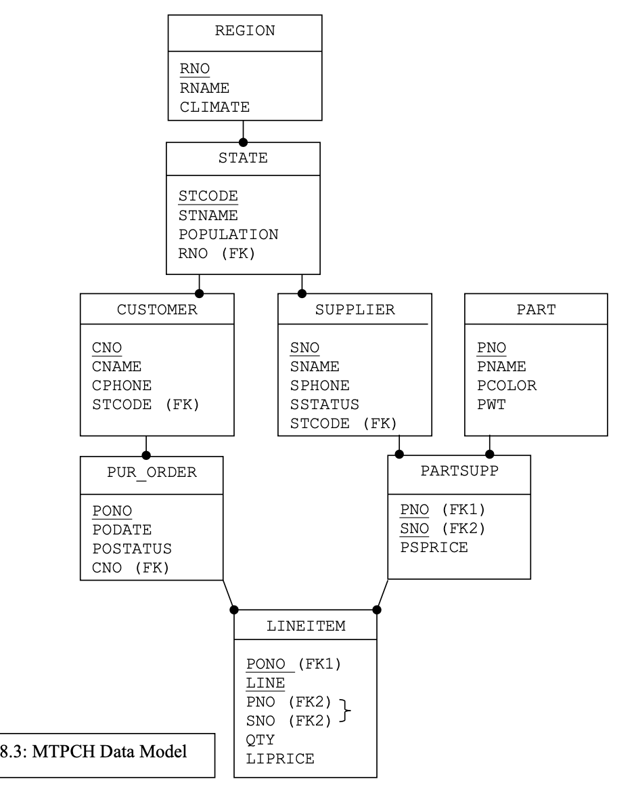

# Instruções

- Na aula de hoje, utilizaremos o banco de dados `multijoin.sqlite` [que está ni Github](https://github.com/ctruciosm/SQL4Statisticians/blob/main/multijoin.sqlite).


# Configurando Rstudio

```{r, echo=TRUE, warning=FALSE}
#| code-fold: FALSE
library(DBI)
library(RSQLite)
con <- dbConnect(RSQLite::SQLite(), "multijoin.sqlite")
```

# SQL


1. Quais tabelas temos no banco?


```{sql connection=con}
SELECT name
FROM sqlite_master
WHERE type = 'table'
```





2.  Acesse as tabelas REGION e STATE. Para cada estado, exiba os valores de STCODE e STNAME, juntamente com os valores RNO e RNAME da região à qual ele pertence. Apresente as colunas na seguinte ordem, da esquerda para a direita: RNO, RNAME, STCODE e STNAME. Ordene o resultado por STCODE dentro de cada RNO (ou seja, primeiro agrupe por RNO e, dentro de cada região, ordene os estados por STCODE).


:::: {.columns}
::: {.column width="50%"}
```{sql connection=con}
PRAGMA table_info(REGION)
```
:::

::: {.column width="50%"}
```{sql connection=con}
PRAGMA table_info(STATE)
```
:::
::::


```{sql connection=con}
SELECT S.RNO, RNAME, STCODE, STNAME
FROM REGION AS R INNER JOIN STATE AS S
ON R.RNO = S.RNO
ORDER BY S.RNO, STCODE
```

3.  Acesse as tabelas PART e PARTSUPP. Para cada peça que pode ser adquirida de algum fornecedor, exiba os valores PNO e PNAME da peça, o valor SNO do fornecedor e o preço (PSPRICE) pago ao fornecedor pela peça. Apresente as colunas na seguinte ordem, da esquerda para a direita: PNO, PNAME, SNO e PSPRICE. Ordene o resultado por SNO dentro de cada PNO (ou seja, primeiro agrupe por PNO e, dentro de cada peça, ordene os fornecedores por SNO).


:::: {.columns}
::: {.column width="50%"}
```{sql connection=con, echo=FALSE}
PRAGMA table_info(PART)
```
:::

::: {.column width="50%"}
```{sql connection=con, echo=FALSE}
PRAGMA table_info(PARTSUPP)
```
:::
::::


```{sql connection=con, echo=FALSE}
SELECT P.PNO, PNAME, SNO, PSPRICE
FROM PART AS P INNER JOIN PARTSUPP AS UP
ON P.PNO = UP.PNO
ORDER BY P.PNO, SNO
```

4.  Acesse as tabelas REGION, STATE e CUSTOMER. Para todos os clientes, exiba os valores CNO e CNAME, juntamente com os valores STCODE e STNAME do estado ao qual pertencem, bem como os valores RNO e RNAME da região correspondente. Apresente as colunas na seguinte ordem, da esquerda para a direita: RNO, RNAME, STCODE, STNAME, CNO e CNAME. Ordene o resultado por CNO dentro de cada STCODE, e por STCODE dentro de cada RNO (ou seja, primeiro por região, depois por estado e, por último, por cliente).


```{sql connection=con, echo=FALSE}
PRAGMA table_info(CUSTOMER)
```


```{sql connection=con, echo=FALSE}
SELECT R.RNO, RNAME, S.STCODE, STNAME, CNO, CNAME
FROM REGION R INNER JOIN STATE S INNER JOIN CUSTOMER C
ON R.RNO = S.RNO AND S.STCODE = C.STCODE
ORDER BY R.RNO, S.STCODE, C.CNO
```

5.  Acesse as tabelas PART, SUPPLIER e PARTSUPP. Para cada peça que pode ser adquirida de algum fornecedor, exiba os valores PNO e PNAME da peça, os valores SNO e SNAME do fornecedor e o preço (PSPRICE) pago ao fornecedor pela peça. Apresente as colunas na seguinte ordem, da esquerda para a direita: PNO, PNAME, SNO, SNAME e PSPRICE. Ordene o resultado por SNO dentro de cada PNO (ou seja, primeiro por código da peça e, dentro de cada peça, por código do fornecedor).


```{sql connection=con, echo=FALSE}
PRAGMA table_info(SUPPLIER)
```


```{sql connection=con, echo=FALSE}
SELECT P.PNO, PNAME, S.SNO, UP.PSPRICE
FROM PART AS P INNER JOIN SUPPLIER AS S INNER JOIN PARTSUPP AS UP
ON P.PNO = UP.PNO AND S.SNO = UP.SNO
ORDER BY P.PNO, S.SNO
```


6. Para todos os clientes, exiba os valores CNO e CNAME, juntamente com os valores RNO e RNAME da região à qual pertencem. Apresente as colunas na seguinte ordem, da esquerda para a direita: RNO, RNAME, CNO e CNAME. Ordene o resultado por CNO dentro de cada RNO (ou seja, primeiro por região e, dentro de cada região, por código do cliente).

```{sql connection=con}
PRAGMA table_info(CUSTOMER)
```

```{sql connection=con, echo=FALSE}
SELECT R.RNO, R.RNAME, C.CNO, C.CNAME
FROM REGION R INNER JOIN CUSTOMER C INNER JOIN STATE S
ON R.RNO = S.RNO AND S.STCODE = C.STCODE
ORDER BY R.RNO, C.CNO
```


7.  Para cada região que tenha pelo menos um cliente, exiba os valores RNO e RNAME correspondentes à região. Ordene o resultado por RNO.

```{sql connection=con, echo=FALSE}
SELECT DISTINCT R.RNO, R.RNAME
FROM REGION R INNER JOIN CUSTOMER C INNER JOIN STATE S
ON R.RNO = S.RNO AND S.STCODE = C.STCODE
ORDER BY R.RNO
```

8.  Acesse as tabelas REGION, STATE, SUPPLIER, PART, PARTSUPP, LINEITEM e PUR_ORDER:

  * Considere apenas as peças que foram efetivamente compradas, ou seja, aquelas que aparecem em pelo menos um item de pedido de compra registrado na tabela LINEITEM.
  * Para cada peça comprada, exiba o nome da região (RNAME) e do estado (STNAME) onde o fornecedor está localizado, o nome do fornecedor (SNAME), o nome da peça (PNAME), o número do pedido de compra (PONO) e a situação do pedido (POSTATUS).
  * Apresente as colunas na seguinte ordem, da esquerda para a direita: RNAME, STNAME, SNAME, PNAME, PONO e POSTATUS.
  * Ordene o resultado por LINEITEM.PONO dentro de cada PNAME, por PNAME dentro de cada SNAME, por SNAME dentro de cada STNAME e por STNAME dentro de cada RNAME.


```{sql connection=con, echo=FALSE}
SELECT R.RNAME, S.STNAME, SU.SNAME, P.PNAME, L.PONO, PO.POSTATUS
FROM REGION R, STATE S, SUPPLIER SU, PART P, PARTSUPP PS, LINEITEM L, PUR_ORDER PO
WHERE R.RNO = S.RNO AND S.STCODE = SU.STCODE AND PO.PONO = L.PONO AND L.PNO = PS.PNO AND PS.SNO = SU.SNO AND P.PNO = PS.PNO AND PS.SNO = L.SNO
ORDER BY R.RNAME, S.STNAME, SU.SNAME, P.PNAME, L.PONO
```

9.  Estamos interessados apenas nas peças de cor rosa que podem ser adquiridas de algum fornecedor localizado na Região Nordeste (Northeast Region).

  * Exiba o número e o nome da peça (PNO, PNAME), o número e o nome do fornecedor (SNO, SNAME) e o preço que será pago ao fornecedor pela peça (PSPRICE).
  * Exiba também o nome do estado onde o fornecedor está localizado.
  * Apresente as colunas na seguinte ordem, da esquerda para a direita: STNAME, SNO, SNAME, PNO, PNAME e PSPRICE.
  * Ordene o resultado por PNO dentro de cada SNO e por SNO dentro de cada STNAME.
  
  
```{sql connection=con, echo=FALSE}
SELECT S.STNAME, SU.SNO, SU.SNAME, P.PNO, P.PNAME, PS.PSPRICE
FROM REGION R, STATE S, SUPPLIER SU, PARTSUPP PS, PART P
WHERE 
R.RNO = S.RNO AND
S.STCODE = SU.STCODE AND
PS.SNO = SU.SNO AND
PS.PNO = P.PNO AND
P.PCOLOR = 'PINK' AND
R.RNAME = 'NORTHEAST'
ORDER BY S.STNAME, SU.SNO, P.PNO
```

10. Desconsidere as peças de cor rosa cujo preço cobrado pelo fornecedor seja superior a US\$ 11,00.  Para cada região que tenha pelo menos um fornecedor que forneça alguma peça, exiba o número e o nome da região, seguidos do preço médio pago pelas peças disponíveis nessa região.

```{sql connection=con, echo=FALSE}
SELECT R.RNO, RNAME, AVG(PS.PSPRICE)
FROM REGION R, STATE S, SUPPLIER SU, PARTSUPP PS, PART P
WHERE 
R.RNO = S.RNO AND
S.STCODE = SU.STCODE AND
SU.SNO = PS.SNO AND
P.PNO = PS.PNO
AND NOT (P.PCOLOR = 'PINK' AND PS.PSPRICE > 11)
GROUP BY R.RNO, R.RNAME
```


